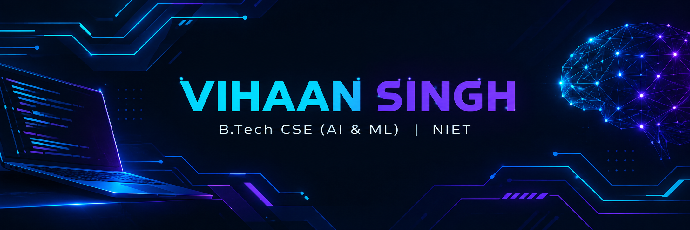

  

  

  
<b>B.Tech CSE (AI &amp; ML) Student · NIET, Greater Noida</b>

  
Learning • Building • Growing 🚀

---

## 👨‍💻 About Me

- 🎓 B.Tech CSE (AI &amp; ML) student at NIET, Greater Noida
- 💻 Currently learning C programming and web development
- 🤖 Interested in Artificial Intelligence, Machine Learning, and software development
- 🌱 Improving my coding and problem-solving skills
- 🎯 Goal: build useful projects and contribute to open source

## 🌐 Connect With Me

  
  
  
  
  

## 🛠️ Tech Stack

### Languages & Web

  
  
  

### Tools

  
  
  

> Add JavaScript, Python, Java, C++, React, or other badges only when you have started learning or using them.

## 📊 GitHub Stats

  
  

## 🔥 Contribution Streak

  

## 🐍 Contribution Snake

  

## 🎯 My Goals

- [ ] Build practical programming projects
- [ ] Improve problem-solving skills
- [ ] Explore AI and Machine Learning
- [ ] Contribute to open-source projects

---

  <i>“Small steps every day lead to big results.”</i>
    
  

